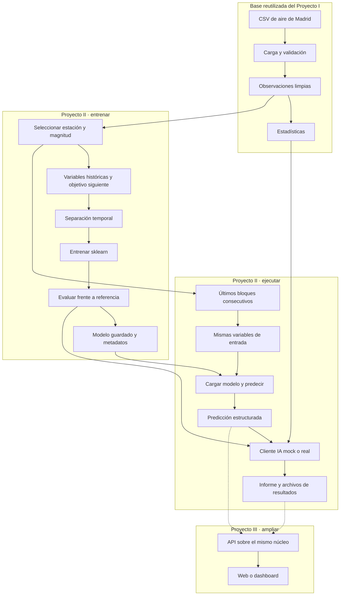

# Guía del Proyecto II: predicción y análisis del aire de Madrid

Esta guía documenta el diseño del Proyecto II a partir de
`../proyecto_i/proyecto_M/` y del enunciado del [Proyecto II](README.md).

**Actualización:** ya existen el enriquecimiento SQLite y el experimento de
variables, entrenamiento y evaluación de OLS/Random Forest, con modelos guardados.
El diseño inicial de abajo sirve de referencia; el método efectivamente ejecutado
y su división train/validación/test están en [MODELADO.md](MODELADO.md), que amplía
la primera propuesta de separación 80/20. La CLI habitual integra la inferencia
y genera el informe en modo mock o real.

## 1. Qué vamos a construir

**Objetivo:** usar los datos históricos de una estación y un contaminante para predecir su valor en el siguiente bloque horario y generar un informe explicativo con IA generativa.

La primera versión trabajará con **una estación y una magnitud**, seleccionadas tras comprobar su cobertura. No hace falta continuar también el pipeline de ventas.

Ejemplo de uso: ejecutar el pipeline sobre la copia local del CSV, obtener estadísticas, cargar un modelo ya entrenado, predecir el siguiente bloque y guardar un informe. La predicción corresponde al bloque posterior al último dato utilizado; si el CSV es antiguo, no es una predicción del momento actual.

## 2. Cómo encaja con las fotos del profesor

En las fotos se distinguen fuentes de datos (CSV/API), ingesta, almacenamiento, análisis y preparación de variables, entrenamiento, un modelo persistido y un camino de carga e inferencia que llega a una API y a consumidores. Algunas anotaciones son poco legibles: la separación concreta que sigue es nuestra adaptación al proyecto, no una transcripción literal.

| Bloque de la pizarra | Aplicación a tu proyecto | Cuándo |
| --- | --- | --- |
| Fuentes CSV / API | CSV horario del Ayuntamiento de Madrid y script de descarga | II |
| Ingesta | Leer, validar y guardar datos y procedencia | II; parte ya existe en el I |
| Almacenamiento, dibujado como cilindro | CSV locales y archivos de resultados; no necesitas una base de datos para empezar | II |
| Análisis y feature engineering | Estadísticas y construcción de variables predictivas | II |
| Entrenamiento con muchos ejemplos | Ajustar y evaluar un modelo sklearn con datos históricos | II |
| Modelo guardado, con formatos como pickle / ONNX anotados | Guardar el modelo con `joblib` y sus metadatos; no hace falta implementar todos los formatos | II |
| Load → inferencia → preparación de respuesta | Cargar el modelo y predecir usando el mismo contrato de variables | II |
| API y consumidores | Publicar las funciones del núcleo y consumirlas desde una web o dashboard | III |

Las dos ramas tienen funciones distintas: **entrenar** aprende de muchos ejemplos; **inferir** aplica lo aprendido a uno o varios ejemplos sin reentrenar. Las marcas de tamaño de la pizarra se interpretan aquí como esa distinción, no como cantidades obligatorias.

La IA generativa se añade porque la exige el enunciado del II, aunque no se identifica claramente como bloque independiente en las fotos.

## 3. Esquema general adaptado

```text
CSV del Ayuntamiento de Madrid
              |
       DESCARGA / INGESTA
       script + origen.json
              |
       CARGA Y VALIDACIÓN                  BASE DEL PROYECTO I
       loader + validator
              |
       DATOS LIMPIOS + ESTADÍSTICAS
              |
       SELECCIÓN Y PREPARACIÓN             NUEVO EN EL PROYECTO II
       una estación + una magnitud
       variables anteriores + calendario
              |
       +------+------------------------------------+
       |                                           |
       v                                           v
  ENTRENAMIENTO                               INFERENCIA
  históricos con objetivo                     datos con historial suficiente
       |                                           |
  separación temporal                         cargar modelo guardado
       |                                           |
  entrenar y evaluar                          construir las mismas variables
       |                                           |
  guardar modelo ---------------------------> predecir
  y metadatos                                      |
       |                                    resultado estructurado
  evaluacion.json                                  |
                                      estadísticas + predicción
                                                   |
                                      IA GENERATIVA: MOCK / REAL
                                                   |
                                      prediccion.json + informe.md
                                                   |
                                      API + WEB / DASHBOARD          PROYECTO III
```

El entrenamiento y la ejecución habitual serán comandos separados. La ejecución habitual cargará el modelo existente.

### Diagrama visual: las dos rutas del proyecto

Este diagrama complementa el esquema anterior. La ruta de entrenamiento genera el modelo; la de ejecución lo utiliza. Las cajas del Proyecto III representan ampliaciones futuras.



**Cómo recorrerlo:** primero comprobar la base, después completar la rama de entrenamiento y por último la de ejecución. Los tests y los logs acompañan ambas ramas. La IA explica resultados; sklearn produce la predicción numérica.

## 4. Qué reutilizar del Proyecto I

| Archivo actual | Qué conservar | Qué revisar al trasladarlo |
| --- | --- | --- |
| `proyecto_M/loader.py` | Lectura del CSV municipal como texto | Rutas configurables |
| `proyecto_M/validator.py` | Conversión H01–H24, estados, nulos, negativos y duplicados | Mantener fecha, bloque e identificadores para ordenar series |
| `proyecto_M/metrics.py` | Estadísticas por estación y magnitud | Añadir un resumen del subconjunto usado por el modelo |
| `proyecto_M/exceptions.py` | Excepciones de dominio | Añadir errores de modelo y cliente IA cuando haga falta |
| `proyecto_M/cli.py` | Argumentos, códigos de salida y gestión de errores | Separar coordinación del pipeline y añadir subcomandos |
| `datos/internet/madrid.py` | Descarga y registro de procedencia | Adaptar destino sin perder URL, fecha y huella |
| Tests de aire | Comprobaciones del comportamiento existente | Adaptar imports y usar muestras pequeñas para las pruebas habituales |

Mantén la entrega del Proyecto I. Copia y adapta su núcleo al proyecto nuevo, conservando su procedencia en la documentación. El II y el III deben continuar en el mismo repositorio del Trabajo Final.

## 5. Estructura propuesta

Este esquema recoge el diseño inicial. La implementación usa `enrich.py` para
SQLite, `compare_modelos.py` para entrenar y `orquestador.py` para coordinar
la inferencia y el informe.

```text
proyecto_ii/
├── aire_app/
│   ├── __init__.py
│   ├── __main__.py       # Entrada python -m aire_app
│   ├── loader.py         # Reutilizado del I
│   ├── validator.py      # Reutilizado del I
│   ├── metrics.py        # Reutilizado del I
│   ├── exceptions.py     # Reutilizado y ampliado
│   ├── config.py         # Rutas, estación, magnitud y modo IA
│   ├── features.py       # Variables comunes a entrenamiento e inferencia
│   ├── train.py          # Entrenamiento, evaluación y persistencia
│   ├── predict.py        # Carga del modelo e inferencia
│   ├── ai_client.py      # Cliente mock y proveedor real
│   ├── pipeline.py       # Coordina la ejecución habitual
│   └── cli.py            # Subcomandos train y run
├── scripts/
│   └── descargar_datos.py
├── datos/
│   ├── origen.json
│   └── aire.csv          # Descargable; excluir de Git si es grande
├── modelos/
│   ├── modelo.joblib
│   └── metadata.json
├── resultados/
│   ├── resumen.json
│   ├── evaluacion.json
│   ├── prediccion.json
│   └── informe.md
├── tests/
│   ├── fixtures/         # CSV pequeño para pruebas sin red
│   ├── test_validacion.py
│   ├── test_features.py
│   ├── test_modelo.py
│   ├── test_ia.py
│   └── test_pipeline.py
├── .env.example
├── .gitignore
├── requirements.txt
├── AI_USAGE.md
└── README.md
```

## 6. Orden de trabajo, paso a paso

### Paso 1. Hacer funcionar la base reutilizada

1. Trasladar carga, validación, métricas y excepciones de aire.
2. Adaptar imports y rutas al paquete `aire_app`.
3. Ejecutar el procesamiento actual sobre una copia local.
4. Adaptar los tests de aire existentes.

**Resultado comprobable:** se obtienen datos válidos, datos excluidos y estadísticas como en el Proyecto I.

### Paso 2. Elegir la serie que vas a predecir

1. Contar datos válidos por estación y magnitud.
2. Examinar fechas disponibles y huecos.
3. Elegir una combinación con suficiente historial consecutivo.
4. Comprobar en la documentación de la fuente el nombre y las unidades de la magnitud.
5. Guardar la elección en configuración y explicarla en el README.

**Resultado comprobable:** puedes decir «predigo la magnitud ___, medida en ___, en la estación ___, para el bloque siguiente».

No mezcles valores de distintos contaminantes como si fueran la misma variable. No fijes códigos sin comprobar que existen y tienen cobertura en tu copia.

### Paso 3. Construir las variables en features.py

Cada ejemplo utilizará información conocida hasta un bloque `t` para predecir el siguiente, `t+1`.

| Campo | Significado |
| --- | --- |
| `valor_actual` | Valor observado en t |
| `valor_anterior` | Valor observado en t−1 |
| `media_3_bloques` | Media de t−2, t−1 y t |
| `bloque_objetivo` | Número del bloque que se quiere predecir |
| `dia_semana_objetivo` | Día de la semana del bloque que se quiere predecir |
| `objetivo` | Valor observado en t+1; solo para entrenar y evaluar |

Ejemplo inventado: si los valores de H02, H03 y H04 son 18, 22 y 24, las entradas en H04 incluyen 24, 22 y una media de 21,33. El objetivo es el valor de H05.

**Reglas:**

- Ordenar por fecha y número de bloque dentro de la serie seleccionada.
- Exigir continuidad de t−2 a t+1 para entrenar; para inferir basta el historial de t−2 a t.
- No unir observaciones separadas por huecos usando simplemente la fila siguiente.
- Excluir ejemplos incompletos y registrar cuántos se pierden.
- Compartir la lógica de variables entre entrenamiento e inferencia.
- Mantener la representación fecha + H01–H24. Documentar el paso de H24 a H01 del día siguiente como sucesión de bloques del archivo, sin atribuirle una conversión horaria con zona no verificada.

**Resultado comprobable:** una tabla pequeña cuyas entradas y objetivos puedes revisar a mano.

### Paso 4. Entrenar y evaluar en compare_modelos.py

1. Cargar, validar, seleccionar y construir ejemplos.
2. Separar entrenamiento, validación y test por fechas, como se detalla en [MODELADO.md](MODELADO.md).
3. Separar por fecha del objetivo y comprobar que ningún objetivo de entrenamiento invade el periodo de evaluación.
4. Entrenar una regresión lineal de sklearn como primera versión.
5. Evaluar en el periodo posterior sin mezclar aleatoriamente las filas.
6. Calcular MAE y RMSE.
7. Calcular las mismas métricas para la referencia «el siguiente valor será igual al actual».
8. Guardar modelo, metadatos y evaluación.

La evaluación propuesta es de un paso: cada predicción puede usar observaciones reales anteriores a su objetivo. No equivale a predecir todo el periodo futuro de una sola vez. Cualquier transformación que aprenda parámetros debe ajustarse solo con entrenamiento.

**MAE:** cuánto se equivoca de media en las unidades del contaminante. **RMSE:** también mide error en esas unidades y penaliza más los errores grandes.

En `metadata.json`: estación, magnitud, unidades, nombres y orden de variables, periodos, versión de dependencias y procedencia de los datos. En `evaluacion.json`: número de ejemplos, métricas del modelo y de la referencia.

**Resultado comprobable:** un comando reproduce el entrenamiento y deja evidencia de si mejora la referencia. Si no mejora, documentarlo; no ajustar repetidamente contra el conjunto final de evaluación.

### Paso 5. Implementar la inferencia en predict.py

1. Cargar `modelo.joblib` y comprobar sus metadatos.
2. Seleccionar los últimos bloques válidos consecutivos de la serie elegida.
3. Construir las entradas con `features.py`, sin necesitar el objetivo futuro.
4. Comprobar columnas, orden y valores finitos.
5. Predecir y devolver un resultado estructurado.

`prediccion.json` debe identificar estación, magnitud, unidades, último bloque observado, bloque objetivo, valor predicho y modelo utilizado. Debe fallar con un mensaje claro si falta modelo o historial suficiente.

**Resultado comprobable:** se predice cargando un modelo existente, sin ejecutar entrenamiento.

### Paso 6. Añadir IA generativa en ai_client.py

Crear una operación común, por ejemplo `generar_informe(resumen, prediccion, evaluacion)`, con dos implementaciones:

- **Mock:** informe simulado determinista, utilizable sin red ni clave.
- **Real:** proveedor identificado en el README, con clave en variable de entorno, timeout y manejo de errores.

Enviar estadísticas agregadas, predicción y evaluación; no es necesario enviar todo el CSV. Pedir un informe breve con datos utilizados, resultado y limitaciones. No inventar causas, cifras o conclusiones sanitarias. El número predicho procede de sklearn.

Guardar `informe.md` identificando si se utilizó mock o proveedor real. Si falla el proveedor real, conservar los resultados numéricos y comunicar el fallo; no presentar una simulación como respuesta real.

**Resultado comprobable:** el modo mock permite completar la demo. Si no hay clave, dejar el proveedor real documentado y el diseño listo, como admite el enunciado.

### Paso 7. Coordinar y añadir logs

`enrich.py` carga, valida y guarda los datos en SQLite. El comando `run` llama
a `orquestador.py` para cargar el modelo, preparar la entrada, predecir y guardar
el resultado y el informe.

Comandos desde `proyectos/proyecto_ii`:

```bash
python -m aire_app.enrich --input ../proyecto_i/datos/internet/aire.csv
python -m aire_app.compare_modelos
python -m aire_app run --ai-mode mock
python -m aire_app run --ai-mode real
python -m pytest
```

Registrar con `logging` inicio y fin de etapas, recuentos, selección de serie, modelo utilizado, rutas de salida y errores. La automatización mínima será una ejecución completa por CLI; un planificador periódico puede añadirse después si aporta valor.

**Resultado comprobable:** un único comando `run` produce la predicción y el informe con un modelo previamente entrenado.

### Paso 8. Pruebas y documentación de entrega

| Prueba | Qué demuestra |
| --- | --- |
| Carga y validación | Se conserva el comportamiento útil del I |
| Variables y objetivos | Desplazamientos correctos y ausencia de información futura |
| Huecos y cambio de día | No se inventa continuidad; se respeta la convención documentada |
| Separación temporal | Los objetivos de entrenamiento preceden a los de evaluación |
| Modelo pequeño | Entrenar, guardar, cargar e inferir funciona |
| Cliente mock | Genera un resultado identificable sin red |
| Errores del cliente real simulados | Timeout o fallo del proveedor se comunica correctamente |
| Integración | Una muestra y un modelo pequeño recorren el pipeline completo |

Añadir dependencias: pandas, numpy, scikit-learn, joblib, pytest y las necesarias para el proveedor/configuración elegidos. `.env.example` contendrá nombres y valores de ejemplo, nunca claves reales; ignorar `.env` y archivos grandes o reproducibles según corresponda.

Documentar en el README: instalación, descarga, selección de serie, entrenamiento, métricas frente a referencia, ejecución mock/real, resultados, tests y limitaciones. Actualizar `AI_USAGE.md` con las herramientas de IA utilizadas, incluyendo esta planificación si se incorpora al trabajo.

**Resultado comprobable:** otra persona puede descargar los datos, entrenar y ejecutar el proyecto siguiendo las instrucciones.

## 7. Qué queda para el Proyecto III

La parte derecha de la pizarra se podrá construir alrededor de las funciones anteriores:

```text
Web / dashboard → API → funciones de predicción y análisis
                         |
                         +→ modelo guardado
                         +→ cliente de IA
```

El prototipo web ya tiene `GET /health` y `POST /predict`. Se puede arrancar con las [instrucciones del README](README.md#arrancar-el-proyecto-iii). El despliegue y la monitorización corresponden al III.

La CLI y la futura API deben llamar al mismo núcleo. Evita que la lógica del modelo dependa de argumentos de terminal o de un servidor web.

## 8. Lista final para seguir el avance

- [x] Base del Proyecto I trasladada y funcionando (14 tests y ejecución con el CSV completo).
- [x] Estación, magnitud y unidades justificadas.
- [x] Variables y objetivo cubiertos por pruebas.
- [x] Huecos temporales tratados de forma explícita.
- [x] Entrenamiento sklearn reproducible y separación temporal.
- [x] Evaluación frente a persistencia.
- [x] Modelo persistido con metadatos.
- [x] Inferencia integrada y separada del entrenamiento.
- [x] Informe IA mock y proveedor real documentado/preparado.
- [x] Pipeline ejecutable por CLI con logs.
- [x] Tests unitarios, de carga/inferencia y de integración.
- [x] `.env.example`, dependencias y README.
- [ ] Revisión de `AI_USAGE.md` por el autor de la entrega.
