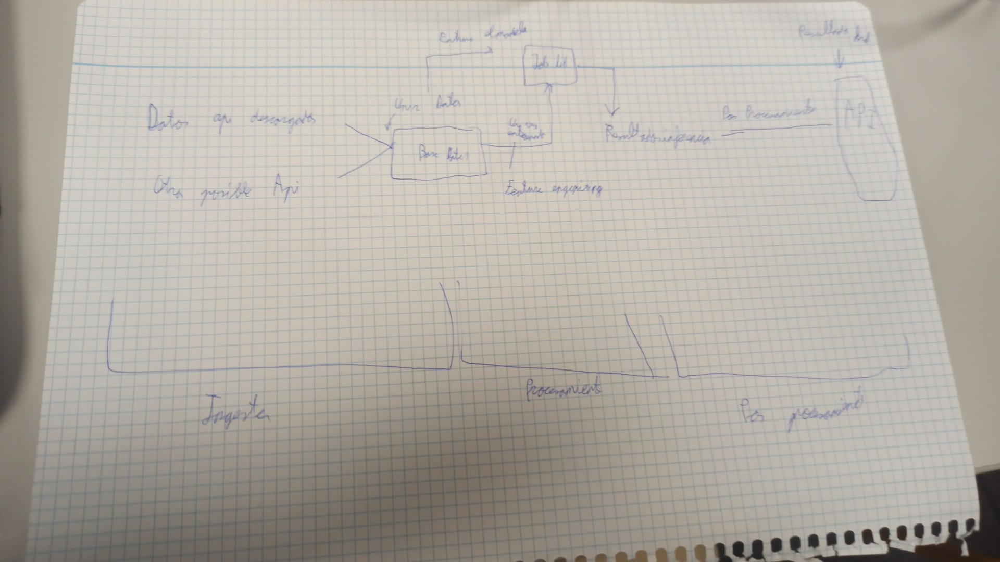
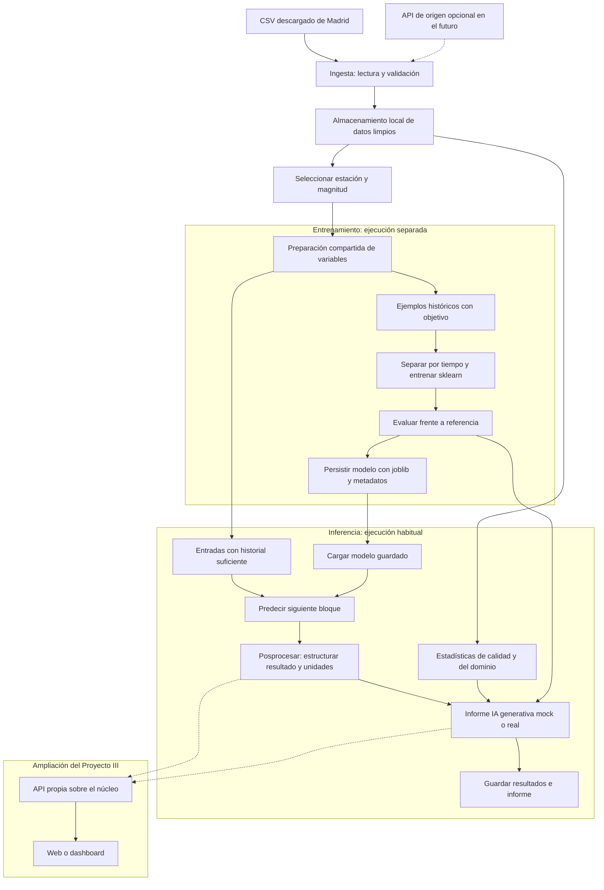

# Pipeline a seguir — aire de Madrid

Referencia de arquitectura para continuar el Proyecto II y ampliarlo en el III.
Basada en el esquema manuscrito del alumno, inspirado en el del profesor.
La secuencia de implementación se detalla en [ESQUEMA_PROYECTO_II.md](ESQUEMA_PROYECTO_II.md).

## Esquema original y lectura

El dibujo es válido como arquitectura general: fuentes → ingesta/almacenamiento
→ preparación → entrenamiento y modelo guardado → inferencia → posprocesamiento
→ API. Se conserva con las precisiones siguientes para guiar la implementación.

La foto permite reconocer CSV descargados, una posible API de origen, base de
datos, entrenamiento del modelo, joblib, inferencia y las etapas inferiores de
ingesta, procesamiento y posprocesamiento. Las anotaciones pequeñas alrededor
del almacenamiento y la rama del modelo, y la anotación superior derecha, se leen
con menos seguridad por el contraste y el desenfoque. No se consideran requisitos
independientes. La disposición de las flechas no separa por completo entrenamiento
e inferencia; la versión siguiente hace explícita esa separación.

## Versión aclarada que seguiremos

Las flechas discontinuas indican opciones o ampliaciones futuras. La API de origen
sería una fuente de datos; la API propia será el servicio que utiliza la web. Son
papeles distintos. La API propia invocará las funciones del núcleo, no dependerá
de leer informes de una ejecución anterior.

## Precisiones necesarias

1. **Lectura y validación antes de trabajar con los datos.** Se reutilizan
   `loader.py` y `validator.py` del Proyecto I, ya trasladados a `aire_app`.
2. **Almacenamiento SQLite implementado.** El CSV original se conserva y la
   ampliación `aire_app.enrich` crea `datos/aire_meteo.sqlite`, con datos de aire,
   meteorología ERA5 y una vista unida. No necesita servidor. Uso y convenciones
   temporales en el README.
3. **Preparar variables antes del modelo.** Elegir una estación y una magnitud,
   ordenar por fecha/bloque y construir entradas con valores conocidos. Entrenar
   e inferir deben usar las mismas variables y convenciones.
4. **Entrenar y predecir son rutas separadas.** Se entrena con históricos, se evalúa
   y se guarda; las ejecuciones habituales cargan el modelo sin reentrenar.
   Joblib es el archivo persistido, no el algoritmo que aprende.
5. **Evaluación temporal explícita.** Reservar un periodo posterior y comparar con
   «el siguiente valor será igual al actual». Evitar información futura y comprobar
   huecos entre bloques; no basta desplazar filas si faltan observaciones.
6. **Posprocesar tiene una función concreta.** Añadir estación, magnitud, unidades,
   bloque objetivo y versión del modelo al resultado. No alterar arbitrariamente
   la predicción para que parezca mejor.
7. **Añadir el cliente generativo exigido en el II.** Sklearn predice el número;
   la IA explica estadísticas, evaluación y predicción. Mock identificable y proveedor
   real documentado/preparado según el enunciado.
8. **API y web en el III.** El dashboard llama a `POST /predict` para ejecutar
   la inferencia del Proyecto II y presentar el informe mock o el de Hugging Face.
   Logs, configuración, errores y tests acompañan todas las etapas.

## Estado y orden de construcción

- **Hecho, paso 1:** carga, validación, estadísticas y exportación mediante CLI;
  14 tests aprobados y contraste del resumen completo con el Proyecto I.
- **Hecho después:** enriquecimiento SQLite con ERA5, preparación de variables y
  comparación OLS/Random Forest para NO₂ en Plaza de España. División temporal
  train/validación/test y candidatos guardados en joblib; ver `MODELADO.md`.
- **Inferencia integrada:** `python -m aire_app run` carga el candidato guardado
  y genera `resultados/inferencia/prediccion.json` desde SQLite. La prueba de
  integración cubre los contratos base y con meteorología.
- **Posprocesamiento:** la misma ejecución guarda `informe.md` con el modo mock
  o con `chat_completion` de Hugging Face. Si falla el proveedor, se conserva
  la predicción.
- **Ejecución completa:** `python -m aire_app pipeline` coordina la auditoría
  del CSV, la unión con ERA5, el entrenamiento, la predicción y el informe.
  CI ejecuta este comando con la serie incluida y el modo mock. El
  [README](README.md#qué-hace-el-orquestador) describe la salida de cada etapa.
- **Proyecto III:** prototipo de API y dashboard sobre el mismo núcleo.
  Quedan despliegue y monitorización.

Esta validación del esquema no implica que los bloques pendientes estén implementados.
