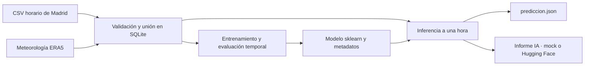

# Proyecto II — Predicción horaria de NO₂ en Madrid

Este proyecto estima la concentración de **NO₂ (µg/m³) una hora después de la
última observación** en Plaza de España (estación `28079004`, magnitud `8`).
Se eligió esta serie por su continuidad y porque permite comparar cuánto
aportan los datos meteorológicos frente al historial de contaminación. El
pipeline reutiliza la carga y validación del Proyecto I.



[Esquema de arquitectura y fotografía](PIPELINE.md) ·
[Detalle del modelado](MODELADO.md) ·
[Informe de evaluación y diagnósticos](docs/RESULTADOS_MODELOS.md) ·
[Enunciado del curso](https://github.com/RSL003/dsia-26-27/blob/608dc3ffaf185474fe0f29a165bd49823aa804d0/proyectos/proyecto_ii/README.md)

## Reproducir la entrega

Desde la raíz del repositorio, con Python 3.12 recomendado, ejecuta:

```bash
cd proyectos/proyecto_ii
python -m venv .venv
source .venv/bin/activate
python -m pip install -r requirements.txt
```

En Windows se puede activar el entorno con `.venv\Scripts\Activate.ps1`
desde PowerShell. Una vez instaladas las dependencias, estos comandos
funcionan sin red ni credenciales. Reconstruyen la serie utilizada en el
informe, comparan los candidatos, cargan el elegido y generan la predicción
y su explicación.

```bash
python -m aire_app.enrich --input datos/reproduccion/aire_plaza_espana.csv --cache datos/reproduccion/era5 --database resultados/reproduccion/aire.sqlite --offline
python -m aire_app.compare_modelos --database resultados/reproduccion/aire.sqlite --models resultados/reproduccion/modelos --output resultados/reproduccion/comparacion
python -m aire_app run --database resultados/reproduccion/aire.sqlite --models resultados/reproduccion/modelos --output resultados/reproduccion/inferencia --ai-mode mock
python -m pytest -q
```

La primera orden valida y une las fuentes en SQLite. El entrenamiento tarda
algo más que las demás etapas y registra el progreso. Deja los joblib y
`metadata.json` en `resultados/reproduccion/modelos/`. En
`resultados/reproduccion/comparacion/` quedan las métricas por candidato,
los diagnósticos y las predicciones de test. La inferencia deja
`prediccion.json` e `informe.md` en `resultados/reproduccion/inferencia/`.

La serie fija de una estación y su respuesta ERA5 se versionan para que la
reproducción no dependa de la fecha de descarga. SQLite, resultados y joblib
se reconstruyen localmente. Carga únicamente modelos joblib de confianza,
como los generados por este entrenamiento.

## Datos y unión

| Fuente | Datos usados | Licencia y procedencia |
| --- | --- | --- |
| [Ayuntamiento de Madrid, calidad del aire](https://datos.madrid.es/dataset/201200-0-calidad-aire-horario/information) | NO₂ horario, del 1 de enero de 2025 al 31 de agosto de 2026 | CC BY 4.0. Descarga del 11 de octubre de 2026. La [ficha de la serie incluida](datos/reproduccion/aire.origen.json) identifica la copia original, el filtro y las huellas SHA-256. |
| [Ayuntamiento de Madrid, catálogo de estaciones](https://datos.madrid.es/dataset/212629-0-estaciones-control-aire/information) | Código, nombre y coordenadas de cada estación | CC BY 4.0. Se incluye el [catálogo](datos/estaciones.csv). |
| [Open-Meteo Historical Weather API](https://open-meteo.com/en/docs/historical-weather-api) | ERA5 horario de Copernicus/ECMWF. Temperatura, humedad, viento y precipitación | CC BY 4.0. La [ficha ERA5](datos/reproduccion/era5/28079004_e495b2c952d58bf9.meta.json) incluye consulta, fecha de descarga y huella SHA-256. |

El validador exige fecha válida, identificadores, estado `V` y valores finitos
no negativos. Descarta todas las apariciones de una clave horaria duplicada.
La ingesta etiqueta cada bloque municipal con su final en hora de Madrid y
lo convierte a UTC. H24 termina a medianoche del día siguiente. Los intervalos
ambiguos o inexistentes durante el cambio de hora conservan su observación,
con tiempo UTC nulo. La vista `aire_enriquecido` une por estación y fin de
bloque UTC y conserva el aire aunque falte meteorología.

La reproducción cubre la serie utilizada para entrenar. Para construir la
base **completa** y actualizada con todas las estaciones, ejecuta:

```bash
python -m aire_app.download_air
python -m aire_app.enrich
python -m aire_app.compare_modelos
python -m aire_app run --ai-mode mock
```

Esta variante necesita red. El CSV municipal se actualiza y los resultados
pueden cambiar. Si ya tienes la copia del Proyecto I, puedes saltarte la
descarga y pasar `--input ../proyecto_i/datos/internet/aire.csv` a
`aire_app.enrich`. Las descargas ERA5 se guardan en `datos/meteo_cache/` y
se pueden reutilizar con `--offline` para el mismo conjunto de consultas.
Para obtener solo la auditoría de calidad del CSV, ejecuta
`python -m aire_app --input datos/reproduccion/aire_plaza_espana.csv`.

## Entrenamiento y resultados

Se comparan OLS y Random Forest con **7 entradas** de historial y calendario
y con **13 entradas** al añadir meteorología del instante de origen. La
referencia es persistencia, que predice el último valor observado. Todos los
candidatos se comparan sobre las mismas filas. Entrenamiento usa 2025,
validación enero–abril de 2026 y test mayo–agosto de 2026, con un bloque
omitido en cada frontera. La elección usa el MAE de validación y el test
queda reservado para evaluar las configuraciones ya elegidas.

| Candidato | MAE validación | MAE test | RMSE test | R² test |
| --- | ---: | ---: | ---: | ---: |
| Persistencia | 3,803 | 3,683 | 5,997 | 0,767 |
| OLS base | 3,440 | 3,614 | 5,432 | 0,809 |
| OLS con ERA5 | 3,384 | 3,510 | 5,347 | 0,815 |
| Random Forest base | 3,168 | **3,194** | 5,169 | 0,827 |
| Random Forest con ERA5 | **3,102** | 3,218 | **5,155** | **0,828** |

MAE y RMSE se expresan en µg/m³. El bosque con ERA5 gana por validación y
reduce el MAE en test un **12,62 %** frente a persistencia. El bosque base
obtiene un MAE de test ligeramente menor. En OLS aparece multicolinealidad
entre los retardos y su media móvil. En ambos bosques y OLS conviene leer
los resultados junto a los diagnósticos de residuos y los límites del
estudio. ERA5 es un reanálisis retrospectivo y la última hora de la base
puede ser histórica.

## Informe generativo

El modo `mock` genera una explicación local reproducible. Para activar el
proveedor real, configura `HF_TOKEN` con un token que tenga permiso para
llamar a Inference Providers. Se usa `chat_completion` de Hugging Face
para explicar en español la predicción y sus métricas de test. El modelo
por defecto es `Qwen/Qwen3-4B-Instruct-2507`. Puedes seleccionar otro
modelo conversacional disponible con `HF_MODEL`. [Ficha del modelo](https://huggingface.co/Qwen/Qwen3-4B-Instruct-2507) · [Documentación de Inference Providers](https://huggingface.co/docs/inference-providers/en/tasks/chat-completion)

Copia [`.env.example`](../../.env.example) en `.env` en la raíz del
repositorio y rellena `HF_TOKEN`. Carga las variables desde la carpeta
del Proyecto II en Bash o Zsh, o configúralas en el entorno de tu servicio.

```bash
set -a
. ../../.env
set +a
python -m aire_app run --database resultados/reproduccion/aire.sqlite --models resultados/reproduccion/modelos --output resultados/reproduccion/inferencia --ai-mode real
```

El estimador sklearn calcula la cifra y el cliente de IA recibe la
predicción estructurada con las métricas históricas. Si la API falla, la
CLI conserva `prediccion.json`, registra el error en `informe.md` y termina
con un código distinto de cero. Pytest cubre la petición y los fallos con
respuestas simuladas.
GitHub Actions ejecuta el pipeline completo en modo `mock`.
El registro del trabajo con IA está en [AI_USAGE.md](AI_USAGE.md).

## Arrancar el Proyecto III

La API y el dashboard reutilizan las mismas funciones de inferencia e informe.
Con los artefactos generados por la reproducción, en macOS, Linux o WSL usa:

```bash
export AIRE_DATABASE=resultados/reproduccion/aire.sqlite
export AIRE_MODELS=resultados/reproduccion/modelos
python -m gunicorn --bind 127.0.0.1:8000 'aire_app.web:create_app()'
```

Abre el [dashboard local](http://127.0.0.1:8000/). El botón **Ejecutar
predicción** llama a `POST /predict` y muestra la estimación y el informe
mock por defecto. Para que el servidor genere informes con Hugging Face,
carga `HF_TOKEN` y añade `export AIRE_AI_MODE=real` antes de arrancar Gunicorn.
Si el proveedor falla, el dashboard muestra la predicción con un aviso.
`GET /health` comprueba la carga del modelo de NO₂ y la existencia de datos.
En el III se ampliará este servicio con despliegue y monitorización.
