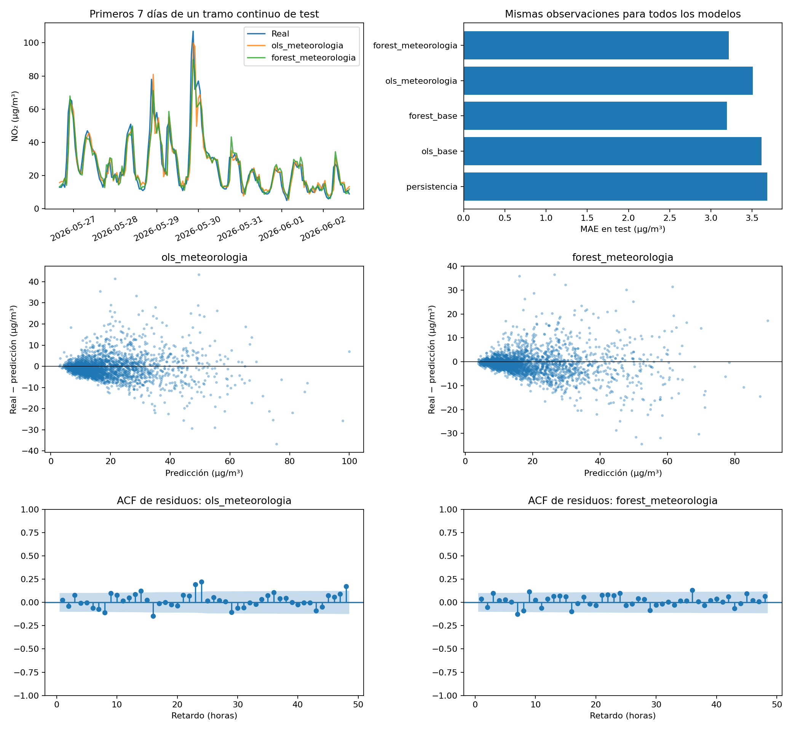

# Resultado de la comparación OLS y Random Forest

Experimento ejecutado sobre la base local de aire y meteorología: NO₂, magnitud 8,
estación 28079004 (Plaza de España), horizonte de un bloque horario.
Método y reproducción en [MODELADO.md](../MODELADO.md). Esta es una fotografía del
experimento inicial, no un resultado general para todas las estaciones.

## División efectiva

| Conjunto | Objetivos UTC | Ejemplos |
| --- | --- | ---: |
| Entrenamiento | 01/01/2025 03:00 — 31/12/2025 23:00 | 8.558 |
| Validación | 01/01/2026 01:00 — 30/04/2026 23:00 | 2.819 |
| Test | 01/05/2026 01:00 — 31/08/2026 22:00 | 2.900 |

Se prepararon 14.279 ejemplos completos y se omitieron dos en las fronteras por
embargo temporal. Se exige historial consecutivo, no se rellenan huecos y todos
los candidatos utilizan las mismas observaciones. El calendario se conoce de
antemano y la meteorología procede del origen t, no del objetivo t+1.

## Errores obtenidos

MAE y RMSE se expresan en µg/m³. El error train corresponde al ajuste solo en train;
validación se predice con ese mismo ajuste. Los modelos de test se reajustan en
train+validación después de congelar parámetros y selección.

| Modelo | MAE train | MAE validación | MAE test | RMSE test | R² test |
| --- | ---: | ---: | ---: | ---: | ---: |
| Persistencia | 4,943 | 3,803 | 3,683 | 5,997 | 0,767 |
| OLS base | 4,488 | 3,440 | 3,614 | 5,432 | 0,809 |
| OLS + meteorología | 4,432 | 3,384 | 3,510 | 5,347 | 0,815 |
| Bosque base | 3,149 | 3,168 | **3,194** | 5,169 | 0,827 |
| Bosque + meteorología | 2,726 | **3,102** | 3,218 | **5,155** | **0,828** |

**La selección previa al test fue bosque + meteorología**, por menor MAE de
validación. Parámetros: 150 árboles, profundidad sin límite, mínimo 5 muestras por
hoja, todas las variables candidatas por división y semilla 42. Esos parámetros
ganaron entre las seis configuraciones de bosque probadas para cada conjunto.

En test reduce el MAE un **12,62 %** frente a persistencia y aproximadamente un
8,32 % frente a OLS con meteorología. No se ha realizado una prueba de significación
de la diferencia entre errores: son mejoras descriptivas de este periodo.

El bosque sin meteorología presenta un MAE test 0,024 µg/m³ menor. No se cambia la
selección después de ver test. La meteorología ayuda en validación y a OLS en test,
pero en el bosque no mejora consistentemente todas las métricas: baja ligeramente
RMSE y sube ligeramente MAE. No puede afirmarse que siempre aporte valor.

## Multicolinealidad: sí existe entre las variables históricas

VIF calculado únicamente con train, en el conjunto con meteorología:

| Variable | VIF |
| --- | ---: |
| Valor actual | 7,72 |
| Valor anterior | 35,51 |
| Media de tres bloques | 49,29 |
| Temperatura | 4,22 |
| Humedad relativa | 4,98 |

El resto presenta VIF menores de 2. La correlación entre valor anterior y media
de tres bloques es **0,985**; temperatura y humedad correlacionan **−0,840**.
El número de condición de la matriz estandarizada con intercepto es **16,22** y
el rango es completo (14/14). No hay dependencia lineal exacta, pero sí una fuerte
redundancia entre los predictores de contaminación.

**Implicación:** interpretar por separado los coeficientes OLS es frágil: cambiar
un retardo manteniendo fija la media que lo contiene no representa una variación
habitual de los datos. Escalar no soluciona esa redundancia. Una siguiente versión
podría comparar una selección de retardos o Ridge, eligiéndola en una nueva
validación temporal. No se ha modificado OLS retrospectivamente tras mirar test.
El bosque no exige predictores sin colinealidad, pero sus importancias pueden
repartirse entre entradas redundantes y no son efectos causales.

## Autocorrelación y residuos

Para no convertir huecos en horas consecutivas, los siguientes diagnósticos de
test utilizan su tramo continuo más largo: **378 horas**, del 26/05/2026 16:00 UTC
al 11/06/2026 09:00 UTC. No representan todo el test de 2.900 observaciones.

| Diagnóstico | OLS + meteorología | Bosque + meteorología |
| --- | ---: | ---: |
| Durbin–Watson, descriptivo | 1,924 | 1,897 |
| ACF residual a 1 hora | 0,025 | 0,038 |
| ACF residual a 24 horas | 0,234 | 0,104 |
| Ljung–Box, hasta 1 hora: p | 0,624 | 0,453 |
| Ljung–Box, hasta 24 horas: p | 2,01 × 10⁻⁷ | 0,00723 |
| Breusch–Pagan: p | 2,96 × 10⁻⁹ | 3,37 × 10⁻⁹ |
| Curtosis residual | 16,37 | 15,22 |

No aparece evidencia fuerte de autocorrelación residual a una hora en ese tramo,
pero **sí queda dependencia al considerar hasta 24 horas**. Un Durbin–Watson próximo
a 2 no basta para descartarla, y con un objetivo retardado entre las entradas no
se usa como prueba clásica concluyente.

Breusch–Pagan y los gráficos sugieren **heterocedasticidad**: los errores crecen
con el nivel de concentración. Sus p-valores se interpretan como exploratorios
porque la dependencia residual puede alterar su calibración. Jarque–Bera produce
p numéricamente 0 en ambos modelos (subdesbordamiento numérico, no probabilidad
exactamente cero), con colas pesadas y asimetría positiva. No conviene asumir
errores normales para construir intervalos de predicción sin comprobaciones.

Los coeficientes OLS con errores HAC de 24 retardos están en los CSV generados.
Se ajustan como diagnóstico separado en **353 horas continuas de train**, del
25/06/2025 15:00 al 10/07/2025 07:00 UTC. Ese tramo corto no representa todo el año.
En el ajuste con meteorología hay 30 observaciones con Cook superior a 4/n y un
máximo de 0,098. Son avisos para investigar influencia, no justificación para
eliminar picos reales. HAC no elimina la dependencia ni demuestra causalidad.

## Sobreajuste, sesgo y límites

- El bosque con meteorología obtiene MAE train 2,726 y validación 3,102. Hay
  optimismo de ajuste; se compararon hojas/profundidades para limitarlo. Las
  diferencias de error también reflejan que los periodos tienen distribuciones
  distintas, no solo sobreajuste.
- La concentración media baja de 24,76 en train a 21,33 en validación y 17,37 en
  test. El test de mayo–agosto tiene una distribución estacional diferente; no
  permite concluir igual rendimiento en invierno.
- En test, el bosque con meteorología sobreestima de media 0,847 µg/m³ y su
  percentil 95 del error absoluto es 10,90 µg/m³. El MAE no describe todos los picos.
- No aparecen predicciones negativas en test; OLS sí produjo algunas en train.
  No se han recortado para mejorar artificialmente las métricas. Los árboles no
  extrapolan fuera de los valores de entrenamiento como lo hace una recta.
- ERA5 retrospectivo no garantiza disponibilidad meteorológica en tiempo real.
- Una división temporal y una estación son una primera comparación, no una
  validación de producción. No hay intervalos de predicción calibrados todavía.

## Modelo que queda guardado

La [reproducción del README](../README.md#reproducir-la-entrega) genera
`forest_meteorologia.joblib`, los otros tres candidatos y `metadata.json`
en `resultados/reproduccion/modelos/`. El artefacto contiene el estimador
reajustado en train+validación y el contrato de variables. El entrenamiento
comprueba que volver a cargarlo conserva las predicciones.

La recomendación para esta primera versión es **mantener el bosque con meteorología
seleccionado en validación** y conservar OLS como modelo interpretable de comparación,
señalando su colinealidad. Antes de ampliar, convendría evaluar nuevos periodos,
retardos diarios y una variante regularizada sin reutilizar este test para elegirlos.

